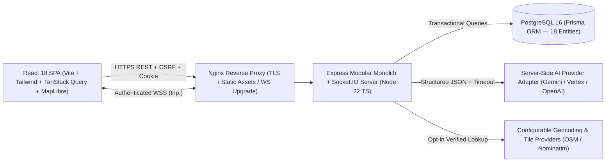

# Roamigo — Production Technical Architecture

---

## 1. System Topology (Modular Monolith)

Roamigo preserves its proven React + Express TypeScript foundation and evolves into a **single-repo modular monolith** backed by **PostgreSQL 16** and **Socket.IO**, avoiding premature microservice or Kubernetes overhead:



### Why Redis Is Omitted Initially
Per Section 5 guidance, **Redis is intentionally omitted** in v1.0: PostgreSQL handles durable sessions, rate-limit buckets/in-memory token buckets suffice for single-node VPS deployments, and in-process Socket.IO rooms synchronise real-time collaboration cleanly. A clean event-bus seam allows adding `@socket.io/redis-adapter` later if horizontal multi-node scaling is required.

---

## 2. Layered Backend Module Structure (`server/`)

Every file strictly respects the `< 200`-line ESLint `max-lines` limit by splitting HTTP routing, validation, domain math, and database access across 16 bounded modules:

- **Modules (`server/modules/<module>/`):**
  `auth`, `users`, `trips`, `members`, `invitations`, `preferences`, `itineraries`, `activities`, `votes`, `budgets`, `expenses`, `ai`, `maps`, `exports`, `notifications`, `health`.
- **Layers per Module:**
  1. `*.routes.ts` — Express `Router` + auth/RBAC/rate-limit middleware wiring.
  2. `*.controller.ts` — Zod request parsing (`req.body`, `req.params`, `req.query`) & standardised JSON envelope `{ ok: true, data, meta }` / `{ ok: false, error: { code, message, fieldErrors } }`.
  3. `*.service.ts` — Orchestrates transactions, permission checks, audit logging, and Socket.IO broadcasts.
  4. `*.repository.ts` — Encapsulated Prisma queries enforcing tenant (`tripId` / `userId`) scoping.
- **Pure Domain Logic (`src/lib/domain/` — shared with frontend & unit-tested independently):**
  - `money.ts` — Integer minor-unit conversions, formatting (`GBP`, `USD`, `EUR`), zero-float invariant checks.
  - `splits.ts` — Equal, exact-custom, and basis-point percentage splitting (`sum === totalMinor` guaranteed).
  - `settlements.ts` — Deterministic minimum-transfer debt simplification.
  - `consensus.ts` — Vote tallies, participation ratios, and conflict flags.
- **OpenAPI 3.1 Specification:** Generated from shared `zod-to-openapi` / contract definitions and served at `GET /api/openapi.json`.

---

## 3. Relational Database Design (PostgreSQL + Prisma)

### 3.1 Core 18-Entity Schema & Key Constraints

| Entity | Primary Purpose | Key Columns, Constraints & Indexes |
| :--- | :--- | :--- |
| `User` | Registered traveller account | `id (UUID PK)`, `email (CITEXT UNIQUE)`, `passwordHash`, `displayName`, `preferredCurrency`, `theme`, `locale`, `deletedAt` |
| `Session` | Cookie-backed auth session | `id`, `tokenHash (UNIQUE)`, `userId (FK CASCADE)`, `csrfSecret`, `expiresAt`, `ipHash`, `INDEX(userId, expiresAt)` |
| `Trip` | Collaborative trip container | `id`, `ownerId (FK)`, `title`, `destinations[]`, `departureCity`, `startDate`, `endDate`, `currency`, `status (DRAFT/ACTIVE/PAST/ARCHIVED)`, `version INT DEFAULT 1` |
| `TripMember` | RBAC membership link | `id`, `tripId (FK CASCADE)`, `userId (FK CASCADE)`, `role (OWNER/EDITOR/MEMBER/VIEWER)`, `UNIQUE(tripId, userId)` |
| `TripInvitation` | Secure invite token | `id`, `tripId (FK CASCADE)`, `email`, `role`, `tokenHash (UNIQUE)`, `status`, `expiresAt`, `invitedById` |
| `TravellerPreference` | Per-trip personal profile | `id`, `tripId`, `memberId (UNIQUE FK)`, `budgetMinor INT`, `accommodationPref`, `transportPref`, `pace`, `accessibilityNotes`, `interests[]` |
| `Itinerary` | Active itinerary pointer | `id`, `tripId (UNIQUE FK)`, `activeVersionId`, `chosenDestination` |
| `ItineraryVersion` | Immutable version history | `id`, `itineraryId (FK CASCADE)`, `versionNumber INT`, `overview`, `compromiseSummary`, `source (AI/MANUAL/IMPORT)`, `UNIQUE(itineraryId, versionNumber)` |
| `ItineraryDay` | Chronological trip day | `id`, `versionId (FK CASCADE)`, `dayNumber INT`, `date`, `theme`, `UNIQUE(versionId, dayNumber)` |
| `Activity` | Scheduled or candidate stop | `id`, `dayId (FK CASCADE)`, `stableKey`, `sortOrder INT`, `title`, `category`, `startTime`, `endTime`, `estimatedCostMinor INT`, `lat DOUBLE PRECISION?`, `lng DOUBLE PRECISION?`, `coordSource`, `compromiseExplanation`, `included BOOLEAN`, `decisionStatus` |
| `Vote` | Per-member activity vote | `id`, `activityId (FK CASCADE)`, `userId (FK CASCADE)`, `direction (UP/DOWN)`, `UNIQUE(activityId, userId)` |
| `Budget` | Shared & category targets | `id`, `tripId (UNIQUE FK)`, `sharedCapMinor INT?`, `accommodationEstMinor INT`, `transportEstMinor INT` |
| `Expense` | Actual incurred group cost | `id`, `tripId (FK CASCADE)`, `paidByUserId (FK)`, `category`, `title`, `amountMinor INT CHECK > 0`, `currency`, `splitMode`, `incurredOn` |
| `ExpenseSplit` | Participant share of expense | `id`, `expenseId (FK CASCADE)`, `userId (FK)`, `shareMinor INT CHECK >= 0`, `basisPoints INT?`, `UNIQUE(expenseId, userId)` |
| `Settlement` | Recorded/suggested Balance Plan | `id`, `tripId (FK CASCADE)`, `fromUserId`, `toUserId`, `amountMinor INT`, `status (SUGGESTED/MARKED_PAID)` |
| `AIRequest` | Token, latency & status log | `id`, `tripId`, `userId`, `provider`, `model`, `operation`, `status`, `durationMs`, `createdAt` *(no raw secrets stored)* |
| `Notification` | In-app invite/vote alerts | `id`, `userId (FK CASCADE)`, `tripId?`, `type`, `payloadJson`, `readAt`, `INDEX(userId, readAt)` |
| `AuditLog` | Security & role change trail | `id`, `tripId?`, `actorUserId?`, `action`, `targetType`, `targetId`, `metadataJson`, `createdAt` |

### 3.2 Transactional Integrity & Legacy LocalStorage Import
- Multi-row mutations (creating expenses + splits, applying AI itinerary versions while migrating votes via `stableKey`, transferring ownership, deleting accounts) execute inside `prisma.$transaction(...)` with runtime verification that `sum(splits.shareMinor) === expense.amountMinor`.
- **`POST /api/trips/import-local`:** Validates a legacy `'roamigo:v1:trip'` payload with `PersistedTripStateSchema`, converts floating-point budgets/costs into exact integer minor units (`Math.round(val * 100)`), and persists the trip, preferences, itinerary version 1, and votes atomically.

---

## 4. Multi-Provider AI Architecture (`server/modules/ai/`)

### 4.1 Provider Interface & Supported Environment Variables
```ts
export interface TravelAIProvider {
  readonly providerId: 'gemini-api' | 'vertex-ai' | 'openai' | 'openai-compatible';
  generateItinerary(req: CanonicalItineraryPrompt, signal: AbortSignal): Promise<ValidatedAiItinerary>;
  proposeModification(req: CanonicalAssistPrompt, signal: AbortSignal): Promise<ValidatedAiProposal>;
}
```
- **Server-side configuration (`server/config.ts`):**
  - `AI_PROVIDER` (`gemini-api` | `vertex-ai` | `openai` | `openai-compatible`; auto-detected from legacy `GEMINI_API_KEY` / `GCP_PROJECT_ID` if omitted for backward compatibility)
  - `AI_MODEL` (or `GEMINI_MODEL` fallback — never hardcoded to unverified IDs)
  - `AI_API_KEY`, `GEMINI_API_KEY`, `OPENAI_API_KEY`
  - `AI_BASE_URL` (server-configured only for `openai-compatible`; never configurable from client requests to prevent SSRF)
  - `GCP_PROJECT_ID`, `GCP_LOCATION`
  - `AI_TIMEOUT_MS` (retains the audited `30000` ms MVP default unless overridden in `.env`)
- **Safety & Privacy Controls:**
  - Only first names/aliases, budgets, trip dates, and travel interests are sent to AI providers—never user email addresses, passwords, session IDs, or private notes marked confidential.
  - Every upstream response is parsed as JSON and validated via strict Zod schemas before touching domain services.

---

## 5. Real-Time Sync, Security & DevOps

1. **Socket.IO Collaboration (`server/realtime/`):**
   - Handshake authenticates the `HttpOnly` session cookie and verifies `TripMember` membership before joining `trip:<tripId>`.
   - Broadcasts `vote:updated`, `activity:updated`, `itinerary:versioned`, `expense:changed`, and `member:changed` carrying `{ tripId, version }`. Clients detecting a version gap automatically invalidate TanStack Query caches to refetch authoritative PostgreSQL state.
2. **Defense-in-Depth Security:**
   - Passwords hashed with Node `crypto.scrypt` (`N=16384, r=8, p=1`, 16-byte random salt, timing-safe comparison).
   - `HttpOnly; SameSite=Lax; Secure (in prod)` session cookie paired with per-session `X-CSRF-Token` verification on all state-mutating `POST`/`PATCH`/`PUT`/`DELETE` routes.
   - `helmet` security headers, strict CORS origin allowlist, `100kb` default JSON body limit, auth/AI endpoint rate limiters, and Prisma parameterised queries preventing SQLi.
3. **Container & CI Pipeline:**
   - Multi-stage `Dockerfile` (`node:22-alpine` builder -> non-root production runner with `HEALTHCHECK` hitting `/api/health`).
   - `docker-compose.yml` orchestrating `db` (`postgres:16-alpine` with named volume & healthcheck), `app` (running `prisma migrate deploy` + server), and optional `nginx` TLS reverse proxy (`deploy/nginx/roamigo.conf`).
   - `.github/workflows/ci.yml` running `npm ci`, `prisma generate`, `lint`, `typecheck`, unit + PostgreSQL service-container integration tests, `build`, Playwright E2E tests, and `npm audit --audit-level=high`.
